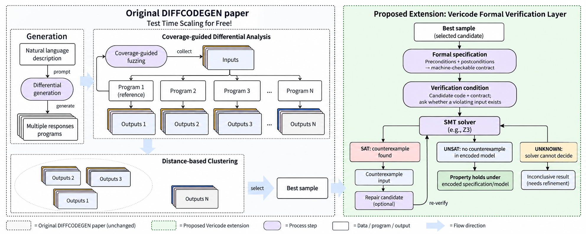

# vericode-sdk
small SDK that runs LLM-generated code through fuzzing and formal verification to catch issues, find counterexamples, or prove it’s correct before execution..

## Install

```bash
pip install vericode-sdk
```

```python
from vericode import differential_analysis, generate_candidates, select_candidate, spec_from_contract, verify

candidates = generate_candidates("Return the area of a circle", llm, n=5, func_name="area")
chosen = select_candidate(differential_analysis(candidates, "area", arity=1))
spec = spec_from_contract("area", ["r"], "r >= 0\nresult == pi * r * r")

print(verify(chosen["code"], spec))
```

`llm` is any callable that takes a prompt string and returns a completion string.

## Architecture



vericode-sdk builds on the test-time scaling approach from
[*Code Generation by Differential Test Time Scaling*](https://arxiv.org/pdf/2605.20473v1) (DIFFCODEGEN).
The paper's idea: sampling an LLM multiple times for the same coding task produces candidates that share
the same intended behavior but differ in implementation. Rather than spending extra LLM calls to judge which
candidate is best, DIFFCODEGEN treats the candidates as a differential-testing problem — it fuzzes one
candidate with coverage-guided input generation, runs every candidate on those inputs, clusters candidates by
how similarly they behave, and picks the medoid of the largest cluster as the selected output. This gets a
pseudo-oracle "for free," without any additional model inference.

vericode-sdk implements that pipeline (`generate_candidates` → `differential_analysis` → `select_candidate`)
and extends it with a **formal verification layer** on top of the selected candidate:

1. **Candidate generation** (`generate_candidates`) — sample diverse candidates from an LLM for the same
   natural-language requirement.
2. **Differential analysis** (`differential_analysis`, `run_fuzz_input(s)`) — coverage-guided fuzzing
   synthesizes inputs, runs all candidates on them, and records their behavioral traces.
3. **Clustering & selection** (`select_candidate`) — candidates are clustered by behavioral distance; the
   medoid of the largest cluster is selected as the most likely-correct implementation, with no extra LLM
   inference.
4. **Specification derivation** (`spec_from_contract`, `spec_from_requirement`, `Spec`) — unlike DIFFCODEGEN,
   which stops at empirical candidate selection, vericode-sdk turns the natural-language requirement (or an
   explicit pre/post-condition contract) into a formal `Spec`.
5. **SMT solving** (`solve`) — the selected candidate and its spec are encoded and checked with an SMT solver.
6. **Verdict interpretation** (`interpret`, `verify`) — the solver result is interpreted as proven-correct,
   or as a concrete counterexample showing an input that violates the spec.

In short: DIFFCODEGEN selects the best candidate by behavior alone; vericode-sdk adds a second pass that
either formally proves the selected candidate correct against a derived specification or produces a
counterexample, rather than relying solely on dynamic/behavioral agreement between candidates.

## References

- He, Y., Wang, E., Wang, J., Ouyang, X., & Chen, H. *Code Generation by Differential Test Time Scaling*.
  [arXiv:2605.20473v1](https://arxiv.org/pdf/2605.20473v1) [cs.SE].

## Release

**Automatic (recommended):** one-time, add a trusted publisher on PyPI
(owner `rajarshidattapy`, repo `vericode-sdk`, workflow `publish.yml`, environment `pypi`).
Then bump `version` in `pyproject.toml` + `src/vericode/__init__.py`, tag, and publish a GitHub release.

**Manual:**

```bash
pip install -e ".[dev]"
pytest
python -m build
twine upload dist/*   # username: __token__, password: your PyPI API token
```
